<p align="center">
  
</p>

<h1 align="center">Saajha · साझा</h1>

<p align="center">
  <b>An agentic, voice-first compliance munshi for India's micro enterprises.</b><br>
  The buyer funds it. The supplier just speaks. Every invoice is filed, confirmed and paid on time.
</p>

<p align="center">
  
  
  
  
  
</p>

<p align="center">
  <a href="#run-the-prototype"><b>Run the prototype</b></a> ·
  <a href="docs/IDEA.md">Idea brief</a> ·
  <a href="docs/ARCHITECTURE.md">Agent architecture</a> ·
  <a href="docs/FIELD-RESEARCH.md">Field research</a> ·
  <a href="docs/DEMO-SCRIPT.md">Demo script</a>
</p>

---

## Built for Tech4Bharat 2026

**Tech4Bharat 2026**, the national student hackathon of the Global Accelerators Vision Summit (Karnataka Arya Vysya Mahasabha × JanAI × RV College of Engineering). Grand Finale: 27 December 2026, Bangalore Palace, Bengaluru.

**Theme 3: MSME Finance & Compliance → Problem statement 3.1: Compliance paperwork.**
Micro enterprises lose time and profit to compliance paperwork.

### How Saajha meets the Tech4Bharat requirements

| Requirement | How Saajha meets it | Where to see it |
|---|---|---|
| **Voice-first, vernacular** for low-literacy users on entry-level Android with unreliable connectivity | Bills spoken in Hindi on WhatsApp; every screen has "Read aloud"; missed-call IVR + SMS for keypad phones | *Speak a bill*, *Feature phone* |
| **Agentic AI:** plans across steps, keeps case memory, recovers from failures | The **Munshi agent** plans each case, remembers buyer habits, and falls back WhatsApp → SMS → voice call when a channel fails | *Agent: memory & recovery* |
| **Human approval** before money, legal or personal-data actions | Buyer confirms delivery; owner approves legal reminders; owner signs with DSC; CA approves filings; consent before any bank data | *Agent*, *JanAI Café*, *CA cockpit*, *Get paid today* |
| **Assisted path via JanAI Café** where documents, authentication or presence are needed | Agent routes DSC signing, Udyam updates, GST registration and KYC to the nearest JanAI Café operator | *JanAI Café console* |
| **Explicit consent, minimum data** | Voice-read consent; bank data off by default; never takes contacts, location, gallery or Aadhaar number | *Consent (first use)* |
| **Mock integrations disclosed and labelled** | Every simulated GSTN, GSP, TReDS and portal step carries a dashed **SIMULATED** tag; *System status* lists what is real and what is simulated | All screens, *System status* |
| **Working prototype, measurable AI quality** | Real backend: Gemini extraction with schema validation and fallbacks, rules engine, signed ledger, agent loop, 21 tests, labelled evaluation with a hold-out set | *System status*, *AI monitoring*, *Tamper test* |
| **Field research first** | Interview plan with owners, buyers, CAs and café operators | [docs/FIELD-RESEARCH.md](docs/FIELD-RESEARCH.md) |
| **Entrepreneurial: market, model, scale, job creation** | Buyer-paid subscription; Saajha Sathi jobs (~1 per 150 businesses); CAs serve more clients | *Landing → Jobs it creates*, *JanAI Café* |

## The problem

| Time lost | Profit lost |
|---|---|
| Writing GST invoices by hand | Late fees and interest on missed returns |
| Sending bills and statements to the CA | Input tax credit lost in the Invoice Management System (IMS) |
| Accepting or rejecting purchase bills in IMS | Big buyers dropping vendors who file late |
| Chasing buyers for payment | Payments 60–90 days late, borrowing at high informal rates |

## The insight

Since **1 April 2026**, the micro supplier's compliance is the **buyer's** money problem too:

- **IMS is mandatory**; a buyer's ITC cannot exceed GSTR-2B, built from the *supplier's* GSTR-1 (CGST Sec 16(2)(aa)). A supplier who files late blocks the buyer's credit.
- **Income-tax Act 2025, Sec 37(2)(g)** (formerly 43B(h)): a buyer who pays a micro or small supplier after 15/45 days loses the deduction.
- **MSMED Act Sec 15–16**: late payment carries compound interest at 3× the RBI bank rate.

So Saajha flips who pays: **the buyer sponsors its micro suppliers' compliance**; the supplier pays nothing.

## How it works

1. **Consent.** Read aloud in Hindi; only the data filing needs.
2. **Speak the bill.** A WhatsApp voice note (or bill photo) becomes a GST invoice.
3. **Buyer taps "Goods received".** The acceptance date is signed by both sides, starting the 45-day clock.
4. **The Munshi agent takes over the case.** It remembers, follows up, recovers from failed channels, and asks the owner before any legal or money step.
5. **Filed and matched.** GSTR-1 drafted, buyer's IMS pre-matched, CA approves in a batch.
6. **Assisted path.** Anything needing a signature or document goes to a JanAI Café, done with the owner.
7. **Paid on time**, or cash today against the confirmed invoice (TReDS / ULI; also touches Theme 3.2).

Every month the owner gets a **Compliance Loss Statement**: what paperwork cost in hours and rupees.

## What makes it different

| | Saajha | Billing / GST apps | Payment-recovery apps |
|---|---|---|---|
| Who pays | Buyer | Supplier | Supplier |
| Acceptance date signed by both at delivery | ✅ | ❌ | ❌ |
| Agent with case memory and channel fallback | ✅ | ❌ | Partly |
| Purchase-side IMS triage | ✅ | Partly | ❌ |
| Time and money loss measured monthly | ✅ | ❌ | ❌ |
| Law as versioned, cited rules code | ✅ | ❌ | ❌ |
| Works on a keypad phone and via JanAI Café | ✅ | ❌ | ❌ |
| Creates local jobs (Saajha Sathi) | ✅ | ❌ | ❌ |

## Screenshots

| Landing | Speak a bill | Buyer confirms (2 phones) |
|---|---|---|
| 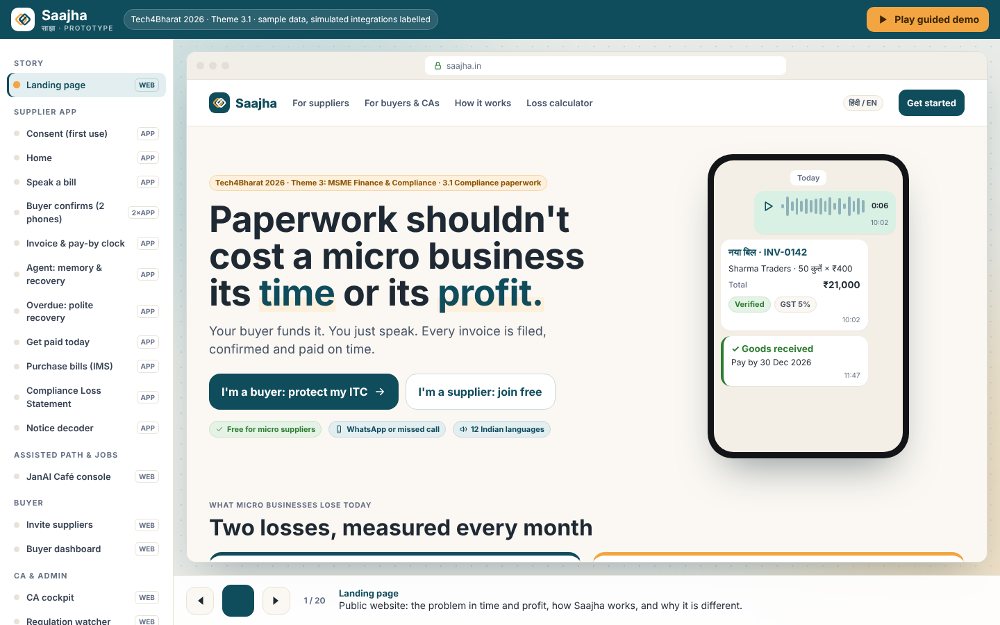 | 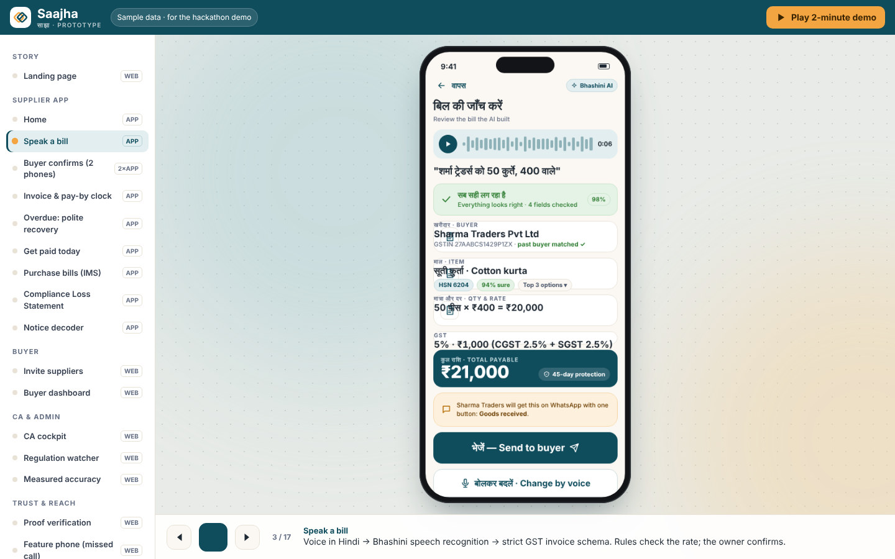 | 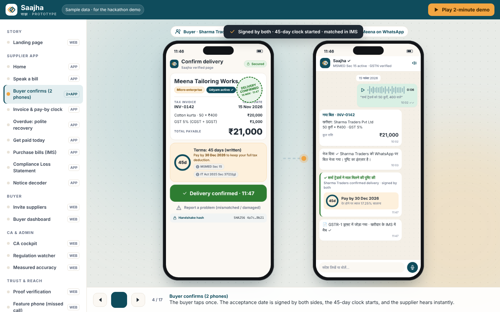 |

| Bill from photo | Tamper test | AI monitoring |
|---|---|---|
| 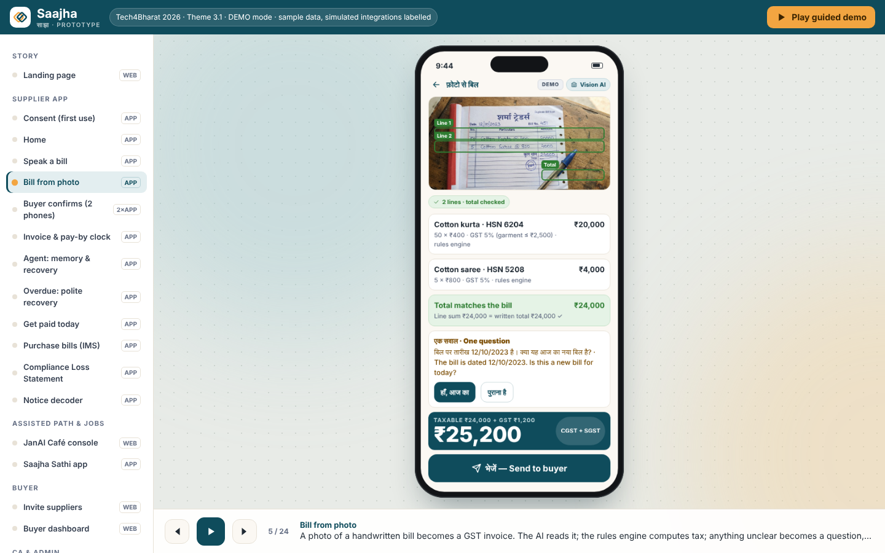 | 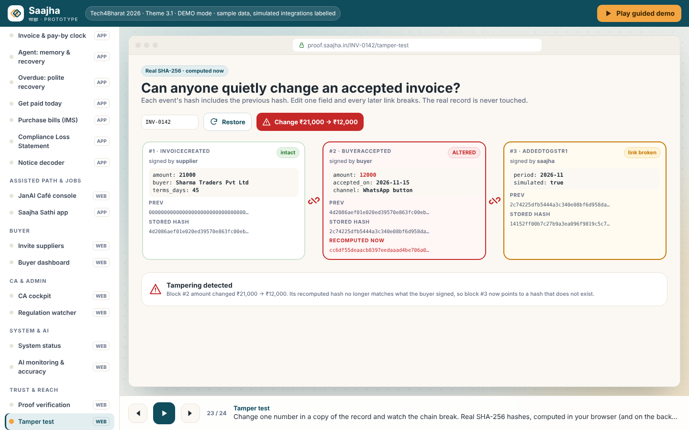 | 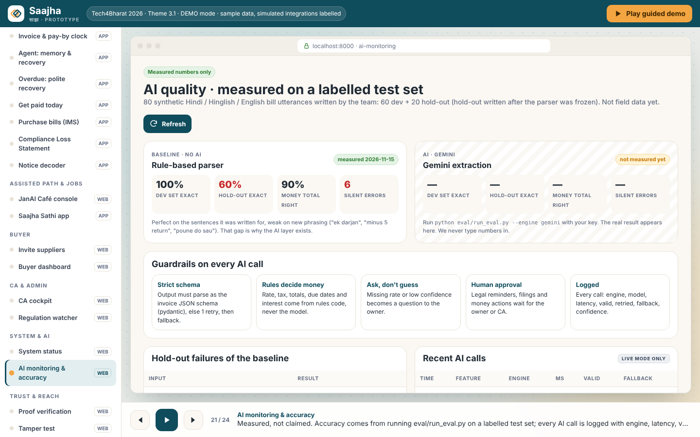 |

| Agent: memory & recovery | JanAI Café console | Consent |
|---|---|---|
| 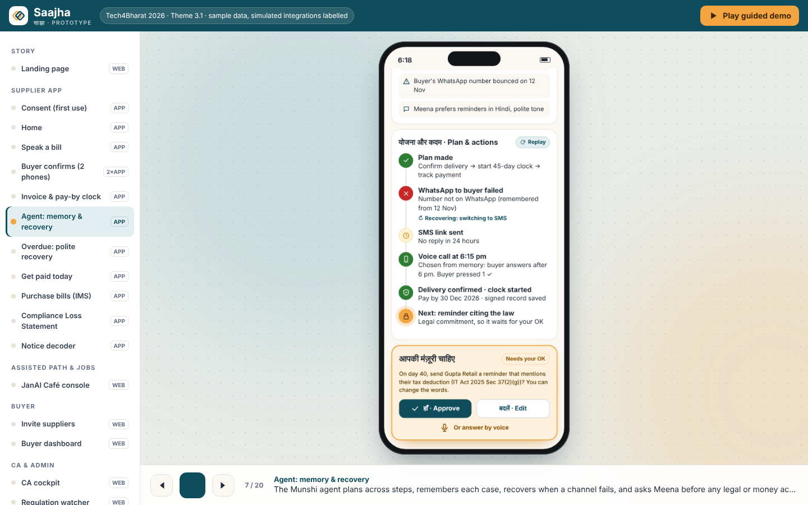 | 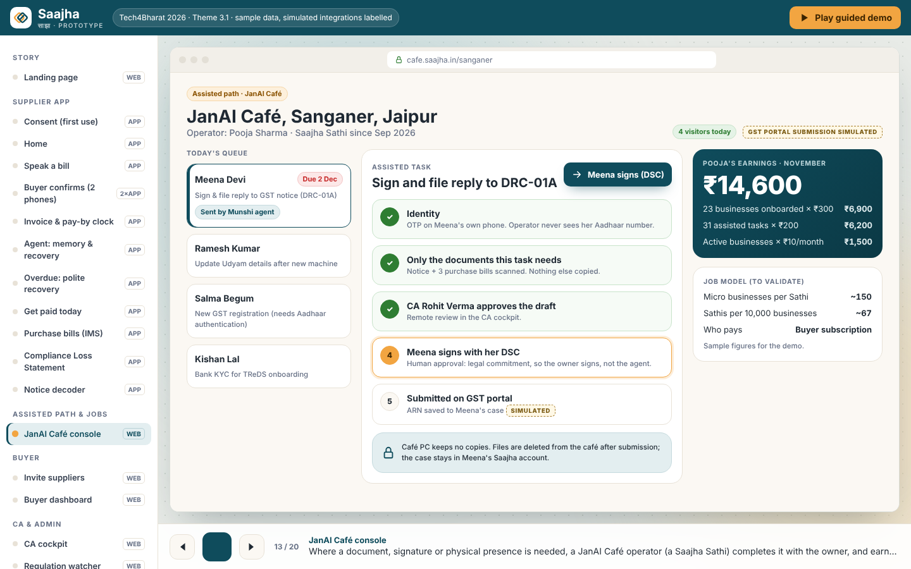 | 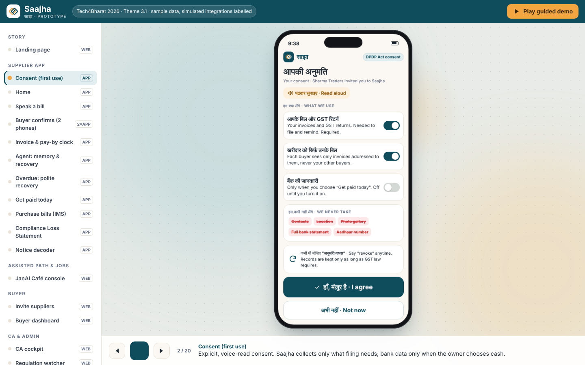 |

| Compliance Loss Statement | Buyer dashboard | CA cockpit |
|---|---|---|
| 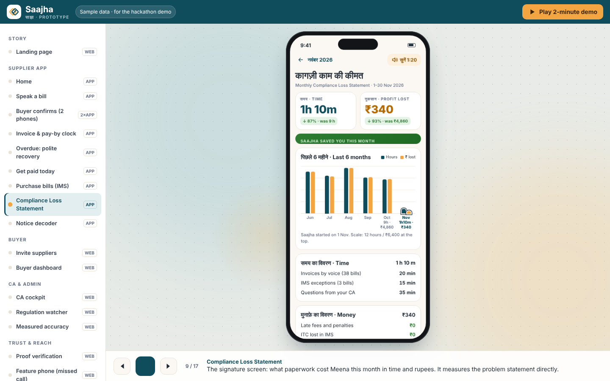 | 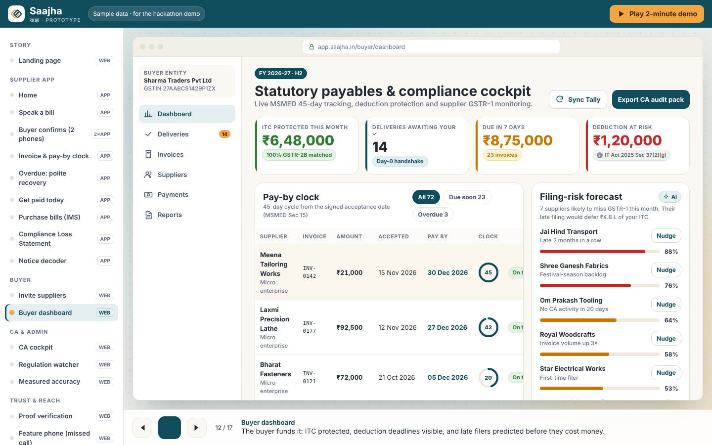 | 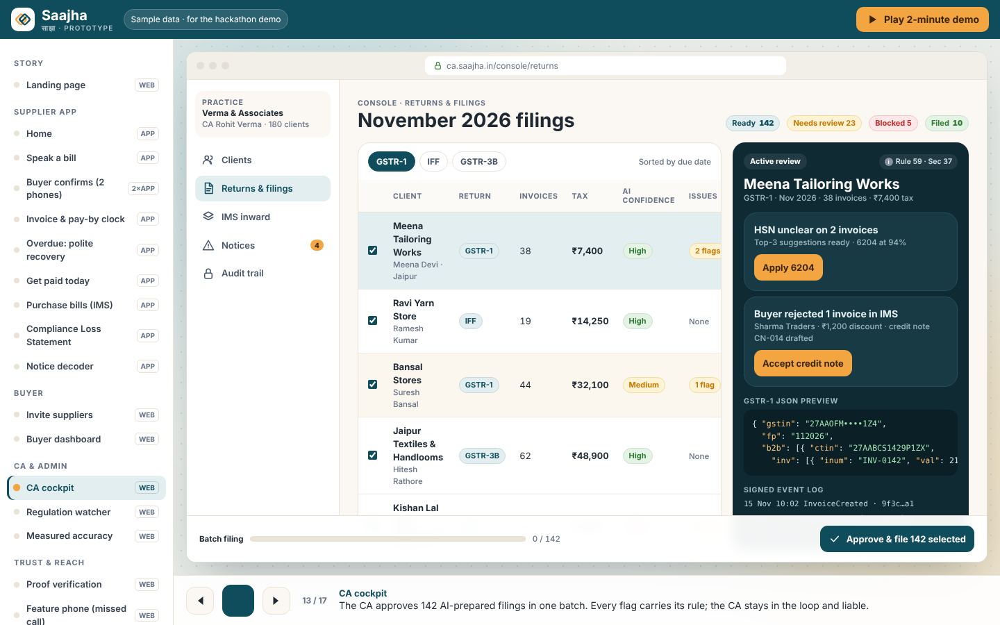 |

## Run the prototype

There are two ways. Both use the same `index.html`.

### 1. Demo mode (no install)

Open `index.html` in Chrome, Edge or Firefox, or use the live page: https://am-berneal.github.io/saajha/
Animated walkthrough with sample data. The header says **DEMO mode**.

### 2. Live mode (real backend + Gemini) — recommended for judging

Needs Python 3.10+ and a free Gemini key from https://aistudio.google.com/apikey

**Windows (PowerShell), one line at a time:**

```powershell
cd saajha\backend
copy .env.example .env
notepad .env
.\run.bat
```

Paste your key after `GEMINI_API_KEY=` in Notepad and save. `run.bat` creates a virtual environment, installs packages, runs the tests and the baseline evaluation, then starts the server. Open **http://localhost:8000**. The header turns green: **LIVE · backend connected · Gemini on**.

**macOS / Linux:** `cd saajha/backend && cp .env.example .env && ./run.sh`

No key? Live mode still works: the backend falls back to the browser's Hindi speech recognition plus a rule-based Hindi/Hinglish parser, and says so on screen.

| Action | How |
|---|---|
| Guided demo with captions | **Play guided demo** (top right) |
| Play / pause | `Space` |
| Previous / next screen | `←` / `→` |
| Jump to any screen | Left menu |

**What is live** (green **LIVE** panels): *Speak a bill* (record or type in Hindi/Hinglish), *Bill from photo* (camera or the sample handwritten bill), *Agent* (real plan → fail → recover → approval loop), *Notice decoder* (photo or text), *Tamper test*, *Proof verification*, *System status*, *AI monitoring*.

## Screens (24)

| Group | Screens |
|---|---|
| Story | Landing page |
| Supplier app (phone) | Consent · Home · Speak a bill · **Bill from photo** · Buyer confirms (2 phones) · Invoice & pay-by clock · Agent: memory & recovery · Overdue recovery · Get paid today · Purchase bills (IMS) · Compliance Loss Statement · Notice decoder |
| Assisted path & jobs | JanAI Café console · **Saajha Sathi app** |
| Buyer (web) | Invite suppliers · Buyer dashboard |
| CA & admin (web) | CA cockpit · Regulation watcher |
| System & AI (web) | **System status** · **AI monitoring & accuracy** |
| Trust & reach | Proof verification · **Tamper test** · Feature phone (missed call) |

## Tech

**Frontend:** one self-contained `index.html` (HTML, CSS, vanilla JS). Detects the backend at load and switches to live mode.

**Backend (`backend/`, working code):**

| Part | What it does | File |
|---|---|---|
| API | FastAPI, serves the prototype and `/api/*` on one port | `app.py` |
| AI layer | Google Gemini (audio, image, text) → strict JSON schema validated with pydantic → 1 retry → fallback. Every call logged. | `saajha_core/ai.py` |
| Offline parser | Rule-based Hindi/Hinglish bill parser (number words like *saadhe teen sau*, Devanagari digits, buyer aliases) | `saajha_core/numparse.py` |
| Rules engine | GST rates, place of supply, MSMED Sec 15/16 due date and interest, GSTR deadlines and late fees. Every result carries rule ID, citation and ruleset version. | `saajha_core/rules.py` |
| Signed ledger | SHA-256 hash chain, Ed25519 signatures per party, verify and tamper test | `saajha_core/ledger.py` |
| Munshi agent | Plan → tools → per-case memory → channel fallback (WhatsApp → SMS → voice → JanAI Café) → approval gate | `saajha_core/agent.py` |
| IMS matcher | Purchase-bill matching with accept / pending / reject suggestions | `saajha_core/ims.py` |
| Evaluation | Labelled Hindi/Hinglish test set + hold-out set, scoring script | `eval/` |
| Tests | 21 pytest tests: rules, parser, ledger tamper detection, agent recovery and approval gate, mocked Gemini retry/fallback, API | `tests/` |

### Measured, not claimed

| Engine | Dev set (60) | Hold-out (20) | Money total right | Silent errors |
|---|---|---|---|---|
| Rule parser (no AI), measured 2026-11-15 | 100% | **60%** | 90% | 6 |
| Gemini | run `python eval/run_eval.py --engine gemini` | | | |

Both sets are **synthetic** utterances written by the team, not field data. The hold-out set was written after the parser was frozen. The parser is perfect on what it was built for and weak on new phrasing, which is exactly why the AI layer exists. The app's *AI monitoring* screen reads these numbers from the evaluation output; nothing is typed in.

> **Design principle:** the AI reads and talks. Every rupee, date and deadline is computed by deterministic rules code with a citation, and a human approves every money, legal or personal-data action.

**Planned production additions:** WhatsApp Cloud API, Bhashini / AI4Bharat speech for more languages, GSP for GSTR-1/IFF and IMS, Account Aggregator, TReDS.

## Simulated integrations (disclosed)

| Integration | Status in prototype |
|---|---|
| GSTN / GSP: GSTR-1 filing, IMS data, notice data | Simulated |
| TReDS / lender offer | Simulated |
| Account Aggregator consent flow | Simulated |
| GST portal submission from JanAI Café | Simulated |
| WhatsApp / SMS / voice-call delivery used by the agent | Simulated (agent logic is real) |
| Speech recognition, invoice extraction, notice reading | **Real** in live mode (Gemini), animated in demo mode |
| Ledger, signatures, tamper test, rules engine, agent, IMS matching | **Real code** |
| Rule-watcher notification, buyer and CA dashboards | Sample data |

All names, GSTINs, amounts and notices are **fictional sample data**.

## Repository structure

```
saajha/
├── index.html                # the prototype (24 screens, demo + live mode)
├── assets/
│   ├── logo/                 # app icon, symbols, favicon
│   ├── samples/              # sample handwritten bill photo
│   └── screenshots/
├── backend/
│   ├── app.py                # FastAPI server (serves index.html + /api)
│   ├── saajha_core/          # ai, rules, ledger, agent, ims, parser, db
│   ├── eval/                 # dataset.jsonl, holdout.jsonl, run_eval.py
│   ├── tests/                # pytest suite
│   ├── samples/              # sample bill for the API
│   ├── requirements.txt
│   ├── .env.example          # GEMINI_API_KEY, GEMINI_MODEL
│   ├── run.bat / run.sh
│   └── README.md
├── docs/                     # IDEA, ARCHITECTURE, FIELD-RESEARCH, DEMO-SCRIPT
├── LICENSE
└── README.md
```

## Team 

| Name | College | Role |
|---|---|---|
| Amberneal Singh | Thapar University | Full Stack Developer |

## Disclaimer

Saajha is a hackathon prototype. Legal references (CGST Act, MSMED Act, Income-tax Act 2025) are summarised for illustration and are not legal or tax advice. Verify with a Chartered Accountant before relying on any figure.

## License

[MIT](LICENSE)
